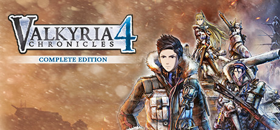

**Valkyria Chronicles 4 returns to the series' roots with a snowbound Eastern Front campaign, following Squad E's desperate march toward the Imperial capital. Features the Grenadier class, ship battles, and improved unit customization.**

---

## 📖 About

Valkyria Chronicles 4 returns to the series' roots with a snowbound Eastern Front campaign, following Squad E's desperate march toward the Imperial capital. Features the Grenadier class, ship battles, and improved unit customization.

## ⚠️ Problems Without Trainer

| Problem | Status |
|---------|--------|
| **Grenadier Class** — Enemy Grenadiers can wipe units in a single turn from across the map | ✅ Solved |
| **Sniper Dominance** — CP-efficient sniper strategies trivialize many missions | ✅ Solved |
| **Medal Grind** — Getting all battle medals requires A-ranking every chapter with specific conditions | ✅ Solved |
| **Chapter Bosses** — Some boss units require very specific counter-strategies | ✅ Solved |

## ✅ Solution

The **Valkyria Chronicles 4 Trainer** solves all these issues by giving you complete control over the game.

## 🎯 Full Feature List

- Unlimited Resources
- God Mode / Invincibility
- Instant Skill Cooldown
- One-Hit Kill
- Freeze Game Timer
- Unlock All Items & Achievements
- Custom Speed Multiplier
- Save State Anywhere

## 🚀 Quick Start

1. **Disable Windows Defender** temporarily (trainer may trigger false positive)
2. Download the trainer from the button above
3. Launch Valkyria Chronicles 4
4. Run the trainer as Administrator
5. Activate desired cheats with hotkeys

## 💎 Free vs Paid

| Feature | Free | Pro |
|---------|------|-----|
| Basic God Mode | ✅ | ✅ |
| Unlimited Resources | ✅ | ✅ |
| All Advanced Cheats | ❌ | ✅ |
| Auto-Updates | ❌ | ✅ |
| Priority Support | ❌ | ✅ |

## 💻 Requirements

- Windows 10/11 (64-bit)
- Valkyria Chronicles 4 (any version)
- .NET Framework 4.8+
- DirectX 11+

## 🍎 macOS

macOS users can use our alternative tool:

## ⚖️ Legal

This trainer is for educational and single-player use only. Use responsibly.

---

